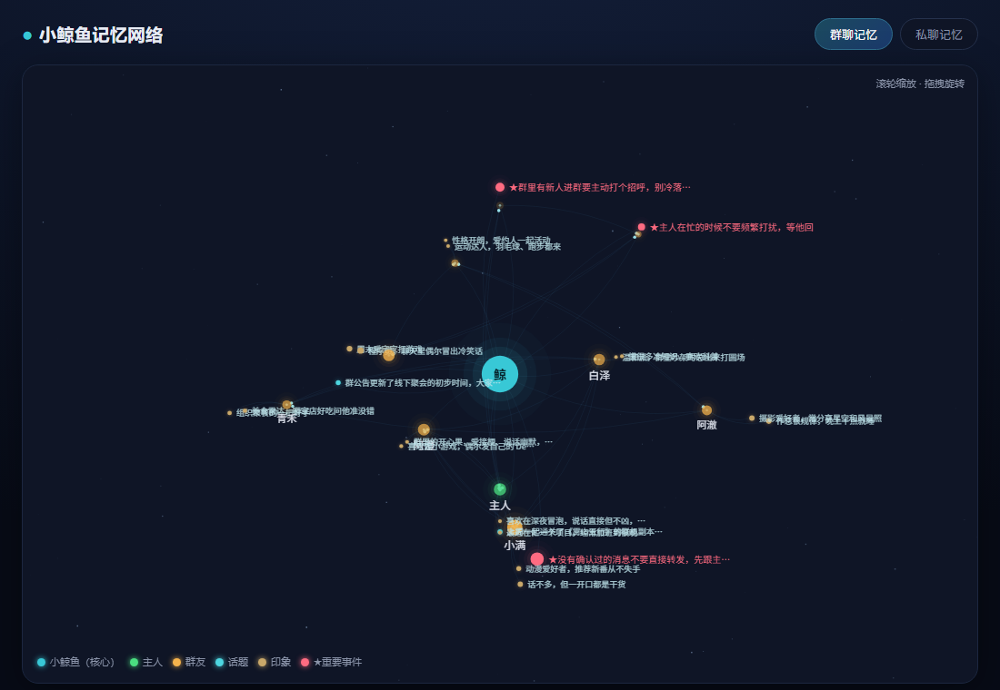
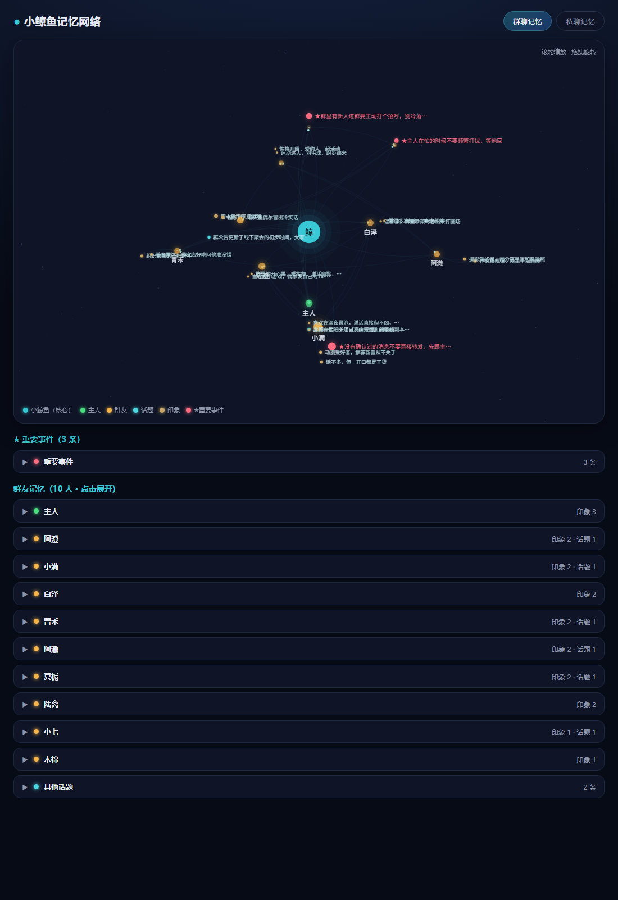

# whale-memory

给 **dsh-onebot-qq** 的记忆子插件：复刻 qq-bridge socialV2 的记忆模型，让 DSH 摆脱 qq-bridge、直接把记忆注入 DSH。

## 宿主要求（先看这条，装错宿主等于没装）

| 项 | 要求 |
|---|---|
| 宿主插件 | [`YUsaltyfish/dsh-onebot-qq`](https://github.com/YUsaltyfish/dsh-onebot-qq)（微内核 + 子插件，契约 `CONTRACT_VERSION = 1`） |
| **不是** | npm 上的同名包 `dsh-onebot-qq@0.10.x`（那是 `mario841859784/dsh-onebot`，单体 `lib/` 架构：**没有** `plugins/` 目录，也没有 `passive-tap` / `before-turn` / `bot.registerTool`，本插件不会被发现和加载） |
| DSH | `>= 0.2.1-rc.2 < 0.3.0`（实测 0.2.2-rc.3 可用） |
| Node | `>= 22`，需 `node:sqlite`（22.5+）与 FTS5 `trigram`（SQLite 3.34+；实测 Node 24.20 自带 3.53 通过） |
| 操作系统 | Windows / Linux / macOS 均可（实测 Windows 通过） |
| 协议端 | 任意 OneBot v11 实现（SnowLuma / NapCat / Lagrange / LLOneBot…），需开正向 WebSocket + HTTP API |

**所需 dsh 插件**：
- **必备**：`dsh-onebot-qq`（上面的 fork，0.1.2）—— whale-memory 挂在它的微内核上，靠它收发 QQ，缺了它本插件不会被发现。
- **可选**：`dsh-onebot-qq-opsgate` —— 把 `ops_*` / agent-team / MCP 资源类工具从 QQ 会话摘掉，减小 token 消耗、降低群聊误调工具的风险。

## 分发 / 上架

这是 **dsh-onebot-qq 的子插件**（不是独立 DSH 插件，不能 `dsh plugin add` 直接装），分发方式：

1. `git clone` 本仓库到本地；
2. 把整个 `whale-memory/` 目录复制（或软链）进 dsh-onebot-qq 源码仓库的 `plugins/` 下（目录名必须等于 `id`，即 `whale-memory`）；
3. 重载 dsh-onebot-qq 或重启 DSH。

> ⚠️ 别把 `whale-memory.json` / `archive.db` 提交进仓库——它们是运行时数据，含真实聊天记录与群友 QQ 号（`.gitignore` 已排除）。

## 安装

1. **装宿主 fork**（两者同名，先移除 npm 那个再装 GitHub 的，避免 pnpm 版本冲突）：
   - GUI：设置 → 插件 → 填 `github:YUsaltyfish/dsh-onebot-qq`
   - CLI：`dsh plugin --profile desktop add github:YUsaltyfish/dsh-onebot-qq`
   - ⚠️ profile 要选**当前在用的那个**（本机 `DSH_PROFILE=desktop`）。装到别的 profile 里，界面里既看不到也不生效。
2. **放子插件**：把整个 `whale-memory/` 目录放进宿主包的 `plugins/` 下（`plugins/<id>/index.js` 自动发现，`id` 必须等于目录名）。
3. **迁移旧数据**（只读 qq-bridge，不写回）：
   ```bash
   node migrate.mjs "D:/AI-deepseek/qq-bridge/state" "<DSH_HOME>/dsh-onebot-qq/whale-memory/whale-memory.json"
   ```
   归档（`chat-archive.jsonl`）会一并迁进同目录的 `archive.db`（FTS5 索引同时建好；7.7 万条约 22 MB / 2 秒）。
4. 在宿主里重载插件或重启 DSH，控制台「QQ 控制台 → 模块」里应出现「鲸鱼记忆」。

> 与 qq-bridge **不能同时接同一个 OneBot 端口**：两个客户端抢一条 WS，会重复回复或握手失败。切换前先停 `node src/bridge.js`。

## 记忆分类与作用域

| 类别 | 作用域 | 遗忘机制 |
|---|---|---|
| 话题 topic | 会话级（`group:群号` / `private:QQ号`） | 超 N 天不注入（默认 3，控制台可调），数据保留 |
| 念头 thought | 会话级 | 带 `expiresAt`，过期不注入 |
| 群友印象 impression | **全局跨会话**（按 QQ 号归档） | 上限可配（默认 50），淘汰「只见过一面且 7 天未出现」 |
| 教训 lesson | **跨群共用** | 上限 50 条 |
| 日记 diary | **只私聊** | 最近 7 天进注入 |

## 消息归档 + 自动回忆

- **归档**：每条入站消息正文截断 300 字进 SQLite `msg` 表 + FTS5（`text` + `keywords` 双列，`trigram`）。**机器人自己说的话也归档**（`bot.onAfterSend`，`self:1`），否则「我上次说过什么」永远想不起来。
- **检索四段式**：token 切分 → FTS `OR`（≥3 字）→ **2-gram IDF 打分**（`skipRecent=40` 排除刚说的话、`POOL_LIMIT=2000` 限量、30 秒进程内缓存）→ 字面 `LIKE` 兜底（2 字词）。
- **分级降级**：0–30 天原文（回忆 90 字）→ 30–90 天打折（18 字 +「记不清细节」）→ 超过 `archiveDays`（默认 90）正文清空、只留关键词（**关键词仍参与打分与 LIKE，仍可搜**）。
- **自动回忆触发词（已收窄）**：`上次/之前/那次/以前/记得/回忆/说过/聊过/提到/问过/昨天/昨晚/昨夜/前天/上周/上个星期` + 印象里的人名（≥2 字）。**不含**「那个/有没有/是不是」，避免每句都触发检索。

## 注入方式（`injectMode`）

| 值 | 行为 |
|---|---|
| `full`（默认） | 每轮回话把记忆快照正文注入上下文，强标记「系统记忆，非群友发言」 |
| `pointer` | 只给一行提示，由模型调 `whale_memory_query` 读 |
| `off` | 不注入，只靠工具手动查 |

> 若发现模型把记忆误当成群友刚说的话，把 `injectMode` 切到 `pointer`（宿主内置的群记忆也是同样的「只给指针」思路）。

## 工具

宿主会统一加 `mcp__qq__` 前缀，模型实际看到的名字是右列。

| 注册名 | 模型看到 | 作用 |
|---|---|---|
| `whale_memory_append` | `mcp__qq__whale_memory_append` | 记话题/念头/印象/教训（印象需给 `uid`=QQ号） |
| `whale_memory_query` | `mcp__qq__whale_memory_query` | 查本会话记忆快照 + 最近日记 |
| `whale_memory_remove` | `mcp__qq__whale_memory_remove` | 按 id 或原文删除 |
| `whale_diary_save` | `mcp__qq__whale_diary_save` | 写私聊日记 |
| `whale_search_history` | `mcp__qq__whale_search_history` | 按关键词翻本会话历史原话（全文检索） |

> **为什么不叫 `memory_append`**：内核把它留给「群记忆积累后台任务」，并用 `MAINT_ALLOWED_TOOLS` 守卫——普通 QQ 会话调用同名工具会直接抛错（「这个工具只能由后台任务调用」）。所以本插件工具一律 `whale_` 前缀。

## 命令

| 命令 | 权限 | 作用 |
|---|---|---|
| `/memory` | 主人（`master`） | 回一条本会话记忆快照；零 token（不叫模型） |

## 配置项（控制台「鲸鱼记忆」页）

| 键 | 默认 | 说明 |
|---|---|---|
| `enabled` | `true` | 总开关：关=不注入、不记录，数据保留 |
| `dir` | `''` | 数据目录；留空 = `<实例数据目录>/whale-memory`。**改了要重载插件** |
| `injectMode` | `full` | 见上表 |
| `topicInjectDays` | `3` | 话题超期不再注入 |
| `maxImpressions` | `50` | 群友印象上限 |
| `recallEnabled` | `true` | 自动回忆开关 |
| `archiveDays` | `90` | 原文保留天数（超期只留关键词） |

除 `dir` 外的配置**热改即生效**（代码里每次回调现读 `bot.cfg`，不在 `setup` 顶部解构）。

## 三条纪律

1. 记忆正文注入必须强标记「系统记忆，非群友发言」。
2. 写盘只有一处（`saveState` 原子写；归档走 SQLite 触发器同步）。
3. 认人只看 QQ 号（昵称常换，号码不变）。

## 可视化记忆网络

内置生成器，把记忆数据渲染成一张**三维神经元网络**面板（自包含 HTML，双击即看，无需服务器）：



- **三色分类**：群友（金黄）/ 话题（青蓝）/ 重要事件（橙红），主人单独**绿色**高亮，核心「鲸」青色
- **3D 立体**：节点分布球壳、透视投影（近大远小）、自动旋转 + 鼠标拖拽 + 滚轮缩放
- **神经元动效**：中心放电波纹、信号沿突触传播、胞体脉动、星云背景



- **折叠式列表**：按「群友」分组，点击展开看该人的**印象**与**关联话题**；教训单独「★重要事件」区块

**两种用法**（生成逻辑同一份，在 `lib/graph.js`）：

1. **插件内（推荐，已打通）**：QQ 里给主人发 `/memory-graph` → 插件直接用内存里的 state 生成，落在数据目录并回路径；模型也可调工具 `whale_memory_graph`。数据是实时的，不用等写盘。
2. **离线手动**：
```bash
node build-graph.mjs "<数据目录>/whale-memory.json" "<数据目录>/memory-graph.html"
```

⚠️ 生成物 `memory-graph.html` 内嵌真实记忆数据，已被 `.gitignore` 排除，别提交进仓库（README 里这两张图是用 `examples/sample-data.json` 脱敏示例数据生成的）。

> 漏迁的日记可用 `backfill-diary.mjs` 单独补迁（只补日记、不碰归档/其他字段、自动备份）：
> ```bash
> node backfill-diary.mjs "<whale-memory.json路径>" "D:/工作区/鲸宝日记"
> ```

## 已知限制

- **打分池只看最近 2000 条**（`POOL_LIMIT`）：单会话消息超过 2000 条后，更早的内容只能靠 FTS（≥3 字原话子串）或 2 字 LIKE 命中，2-gram 打分扫不到。
- 单字查询返回空（与 qq-bridge 一致；请用 ≥2 字）。
- 检索是进程内同步 SQLite 调用；2 万条单会话实测 214–255 ms、堆峰值 +81 MB（有 30 秒缓存 + `skipRecent` 挡掉高频重复）。消息量特别大的群，可调大 `archiveDays` 或调小 `POOL_LIMIT` 前的窗口。

## 测试

```bash
node test/smoke.mjs             # 记忆核心（13 项）
node test/archive-smoke.mjs     # 归档检索（10 项）
node test/host-contract-smoke.mjs  # 接线层：假宿主按契约 v1 跑（15 项）
```

## 文件

```
whale-memory/
├── index.js                    # 子插件入口（契约 v1：passive-tap / before-turn / registerTool / onAfterSend）
├── lib/memory.js               # 结构化记忆核心（无依赖，可单测）
├── lib/archive.js              # 消息归档 + FTS5 检索 + 降级 + 触发词
├── lib/graph.js                # 记忆网络 HTML 生成（纯函数，插件与 CLI 共用）
├── migrate.mjs                 # 从 qq-bridge state/ 迁移（含归档）
├── backfill-diary.mjs          # 补迁漏迁的日记（只补日记、自动备份）
├── build-graph.mjs             # 生成可视化记忆网络 HTML（3D 神经元）
├── examples/sample-data.json   # 脱敏示例数据（生成 README 说明图用）
├── docs/                       # README 说明图（脱敏）
├── test/                       # smoke(13) + archive-smoke(10) + host-contract-smoke(15)
├── package.json / README.md / LICENSE / .gitignore
```

## License

MIT
